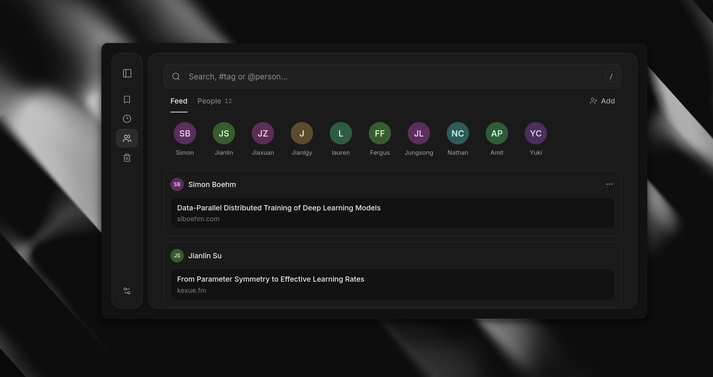
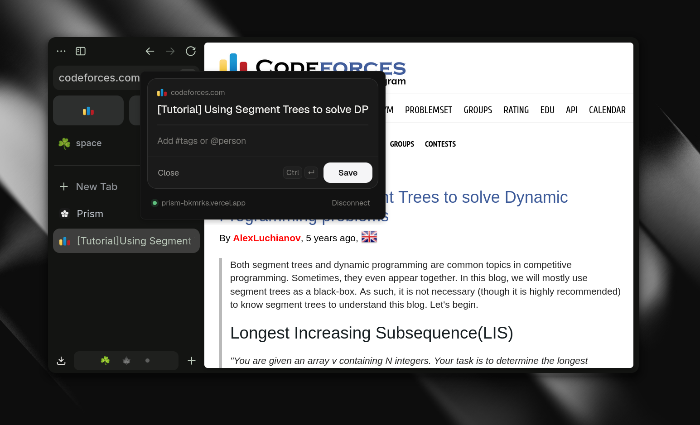

<div align="center">

<picture>
  <source media="(prefers-color-scheme: dark)" srcset="media/logo-light.svg">
  
</picture>

# Prism

**A private, keyboard-first library for the links, posts and people worth keeping.**

[Features](#features) · [Keyboard](#keyboard) · [Search](#search) · [Extension](#browser-extension) · [Setup](#setup)

<br>


</div>

<br>

## Features

- **One omnibar.** Paste a link to capture it, or type to search. `#tags` and `@people` turn into chips as you type.
- **A full query language.** Combine tags, people, sites, dates and kinds, and negate any of them (see [Search](#search)).
- **Vim-style navigation.** `j` `k` `gg` `G` `Ctrl d` `Ctrl u` to move, then `o` `e` `y` to act, so you never have to touch the mouse.
- **Tags.** A dedicated tags explorer, sidebar shortcuts, reordering with `Alt ↑/↓`, and automatic tags for tweets.
- **People.** Profiles with linked identities, plus a feed of everything you've saved by or about each person.
- **Notes and backlinks.** Attach Markdown notes to bookmarks, reference other items, and see what links back.
- **Rich previews.** Tweet cards, auto-fetched titles and cached favicons.
- **Read later and trash.** Queue things up, and restore anything you deleted.
- **Light and dark themes.**
- **Optional public view.** Publish a read-only copy of your library at `/public`.
- **Browser extension.** Save any page, or any post on X, without leaving it.

<table>
  <tr>
    <td width="50%"></td>
    <td width="50%"></td>
  </tr>
  <tr>
    <td align="center"><sub>People feed</sub></td>
    <td align="center"><sub>Capturing a page with the extension</sub></td>
  </tr>
</table>

## Keyboard

Prism has modes, like Vim. In **normal mode** single keys move around and act on the focused bookmark. In **insert mode** your typing goes to the field you're in. `Esc` always takes you back to normal mode. Press `?` in the app to see this list.

| Move around         |                                 |
| ------------------- | ------------------------------- |
| `j` / `k`           | Next / previous bookmark        |
| `gg` / `G`          | First / last visible bookmark   |
| `Ctrl d` / `Ctrl u` | Half a page down / up           |
| `f`                 | Focus the sidebar               |
| `Alt ↑` / `Alt ↓`   | Reorder the focused sidebar tag |

| Capture & search          |                                           |
| ------------------------- | ----------------------------------------- |
| `i`                       | Insert a link                             |
| `/` · `Ctrl K` · `Ctrl F` | Search the library                        |
| `Enter` · `Tab` · `,`     | Turn typed text into a chip               |
| `Backspace` (empty field) | Remove the last chip                      |
| `Ctrl ↵`                  | Save the capture                          |
| `Esc`                     | Clear the field, or return to normal mode |

| Focused bookmark |               |
| ---------------- | ------------- |
| `o` / `Enter`    | Open the link |
| `e` / `Space`    | Edit          |
| `y`              | Copy the link |

| Workspace |                    |
| --------- | ------------------ |
| `,`       | Account & settings |
| `?`       | Keyboard shortcuts |

On macOS, use `⌘` wherever this table says `Ctrl`.

## Search

The omnibar uses one query language everywhere. Each finished filter becomes a chip, but the text query is still what gets stored, so search URLs, the back button and saved views all keep working.

| Query                                                    | Matches                                             |
| -------------------------------------------------------- | --------------------------------------------------- |
| `segment tree`                                           | Those words anywhere in a bookmark                  |
| `"exact phrase"`                                         | That exact phrase                                   |
| `title:dp`                                               | Text in the title only                              |
| `#dp #graphs`                                            | Bookmarks with **all** of these tags                |
| `#dp\|graphs` · `#{dp, graphs}`                          | Bookmarks with **any** of these tags                |
| `@simon` · `@a\|b`                                       | Bookmarks connected to a person (or any of several) |
| `site:codeforces.com`                                    | Links from a site, including its subdomains         |
| `is:page` · `is:social` · `is:tweet`                     | Bookmarks of that kind                              |
| `is:later` · `is:untagged` · `is:trash`                  | Read later, untagged, or trashed bookmarks          |
| `has:note` · `has:tags` · `has:people` · `has:backlinks` | Bookmarks that have that                            |
| `after:7d` · `before:2026-01`                            | By save date: a span (`d` `w` `m` `y`) or a date    |
| `!x` · `-x`                                              | Negates any term above, e.g. `-site:x.com`          |
| `!{a, b}`                                                | Bookmarks with none of these tags                   |

`@` is a person bang. An exact handle or name wins; otherwise a unique prefix is enough, so results narrow while you type.

## Browser extension

Extensions for Firefox ([`extensions/firefox/`](../extensions/firefox)) and Chrome ([`extensions/chrome/`](../extensions/chrome)) share one codebase in [`extensions/shared/`](../extensions/shared). Both capture into the same library with the same tag and person chips.

- **Any page:** press `Alt Shift P`, or click the toolbar button.
- **Posts on X:** a folder button replaces the share icon on every post, so you can save the post in place.
- **[OldTwitter](https://github.com/dimdenGD/OldTwitter):** a filled bookmark appears next to the favorite button.
- **Offline:** saves made while offline are queued and sent once you're back online.

In the capture panel, `Ctrl ↵` saves. The first `Esc` clears what you're typing; the next one closes the panel.

**To pair it:** in Prism, open **Account** (`,`) and generate a pairing code. Paste the code into the extension popup. Codes work once and expire; you can revoke the connection from Prism at any time.

## Setup

**Requirements:** [Bun](https://bun.sh) 1.4, Node 22.17+, a PostgreSQL database (built for [Neon](https://neon.tech)), and Neon Auth.

```sh
git clone https://github.com/annalhq/prism.git
cd prism
bun install --frozen-lockfile
cp frontend/.env.example frontend/.env
```

Fill in `frontend/.env`:

| Variable                  | Purpose                                                     |
| ------------------------- | ----------------------------------------------------------- |
| `DATABASE_URL`            | Pooled Postgres connection used by the app                  |
| `DATABASE_URL_DIRECT`     | Direct connection for migrations and scripts                |
| `APP_ORIGIN`              | Public origin, e.g. `http://localhost:5173`                 |
| `NEON_AUTH_BASE_URL`      | Neon Auth service URL                                       |
| `NEON_AUTH_COOKIE_SECRET` | Secret used to sign the session cookie                      |
| `OWNER_SUBJECT`           | Auth user ID of the library's owner                         |
| `LIBRARY_PUBLIC_VIEW`     | Set to `enabled` to serve a read-only copy at `/public`     |
| `DB_MIGRATION_TARGET`     | Set to `isolated` only when migrating a disposable database |
| `NEON_STORAGE_*`          | Optional Neon Object Storage bucket for person photos       |

Then create the schema and the owner's vault, and start the app:

```sh
bun run db:migrate       # requires DB_MIGRATION_TARGET=isolated
bun run db:init-owner
bun run dev              # http://localhost:5173
```

### Building the extensions

```sh
bun run dev:firefox        # Firefox dev build with live reload
bun run dev:chrome         # Chrome dev build with live reload
bun run build:extensions   # production builds → extensions/{firefox,chrome}/.output/
bun run zip:extensions     # packages → extensions/firefox/.output/*.xpi, extensions/chrome/.output/*.zip
```

Each browser also has its own `build:<browser>` and `zip:<browser>` script.

**Chrome:** open `chrome://extensions`, turn on **Developer mode**, click **Load unpacked**, and pick `extensions/chrome/.output/chrome-mv3`. See [`extensions/chrome/README.md`](../extensions/chrome/README.md).

**Firefox:** to try a build, open `about:debugging` → **This Firefox** → **Load Temporary Add-on**, and pick `extensions/firefox/.output/firefox-mv3/manifest.json`.

To install it permanently in Firefox, it must be signed:

1. Bump the version (`bun run release` bumps every extension package together).
2. Put your [AMO API keys](https://addons.mozilla.org/developers/addon/api/key/) in `extensions/firefox/.env`:

   ```sh
   WEB_EXT_API_KEY=user:...
   WEB_EXT_API_SECRET=...
   ```

3. Run `bun run sign:firefox`.
4. In Firefox, open `about:addons` → ⚙ → **Install Add-on From File…** and pick the `.xpi` from `extensions/firefox/.output/signed/`.

For Zen and other Firefox forks, see [`extensions/firefox/README.md`](../extensions/firefox/README.md).

### Releases

`bun run release && git push --follow-tags` creates a version tag; the
[Extensions workflow](workflows/extensions.yml) then rebuilds both extensions and attaches the
Firefox `.xpi` and the Chrome `.zip` to that tag's GitHub Release. Download the new build from
there (Chrome: unzip, then **Load unpacked**, or replace the files in the folder you already
loaded and press reload). The workflow can also be started from the Actions tab; those runs
upload the packages as a workflow artifact instead.

To have CI sign the Firefox build as well, add `WEB_EXT_API_KEY` and `WEB_EXT_API_SECRET` as
repository secrets; the signed `.xpi` is attached next to the unsigned one.

## Development

| Command               | Purpose                                                |
| --------------------- | ------------------------------------------------------ |
| `bun run dev`         | Start the development server                           |
| `bun run build`       | Build for production                                   |
| `bun run check`       | Type-check the app and both extensions                 |
| `bun run lint`        | Run Prettier and ESLint                                |
| `bun run format`      | Apply formatting                                       |
| `bun run test`        | Run unit tests                                         |
| `bun run db:generate` | Generate SQL from the Drizzle schema                   |
| `bun run release`     | Bump the version and update the changelog from commits |

```
frontend/              SvelteKit app, Drizzle schema and database scripts
extensions/shared/     Browser-neutral extension source, icons and fonts
extensions/firefox/    Firefox extension (WXT)
extensions/chrome/     Chrome extension (WXT)
```

Deploys to Vercel from the repository root using `vercel.json`.

<br>

<div align="center"><sub>Built with SvelteKit, Drizzle, Neon and WXT.</sub></div>
