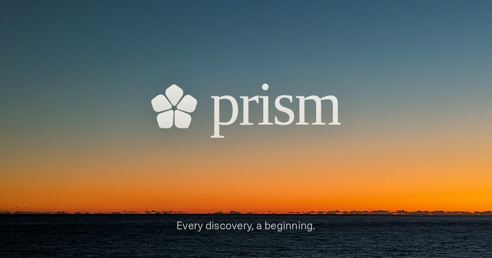
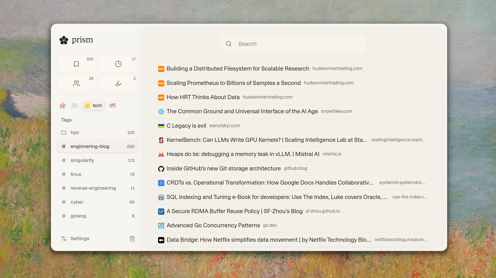
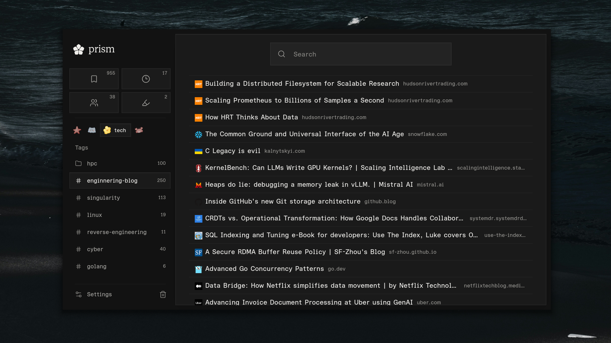
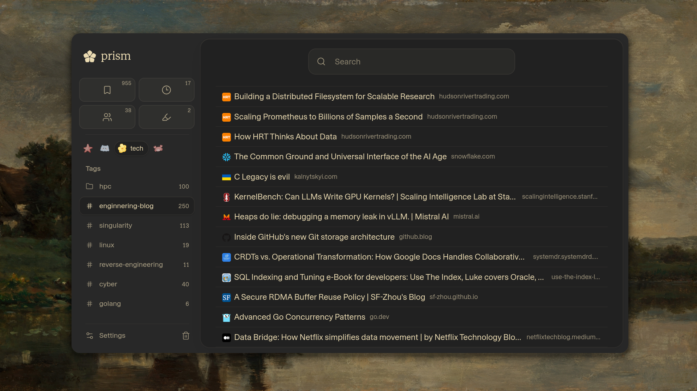

  <h1></h1>
  
<strong>A quiet, self-hosted library for bookmarks, highlights, notes, and the people behind them.</strong>

  

    <a href="#features">Features</a> ·
    <a href="#self-hosting">Self-hosting</a> ·
    <a href="#browser-extensions">Browser extensions</a> ·
    <a href="../docs/using-prism.md">User guide</a> ·
    <a href="https://github.com/annalhq/prism/releases">Releases</a>
  

## Features

### Capture and read

- **Bookmarks and posts.** Save a link in Prism or capture it from Firefox or Chrome. Add tags and connect people as you save. X posts have rich previews, and the extension works with OldTwitter.
- **Highlights.** Save passages from a page and revisit them by source in the Highlights reading view. Copy them as Markdown or show them on the original page when you return.
- **Markdown notes.** Write standalone notes or attach them to bookmarks and people. Link entries in your library and follow backlinks to see where they’re mentioned.

### Organize and revisit

- **Spaces, tags, and folders.** Group tags into folders and arrange them in named Spaces with sticker icons. Reorder your Spaces, choose a default, or swipe between them on mobile.
- **People and posts.** Create profiles with social links and a timeline of related bookmarks and posts. Browse saved posts in the People feed, or narrow it to posts connected to your profiles.
- **Rabbit holes.** Build nested trails of related links to keep the threads of a research session together.
- **Read Later and Trash.** Set pages aside for later. Restore items from Trash or delete them permanently.
- **Search and sort.** Combine text with filters for tags, people, sites, dates, and more. Sort bookmarks by title, newest first, or recently opened.
- **Keyboard navigation.** Browse and edit with Vim-style keys. Use visual mode to move, copy, or trash multiple bookmarks at once. [Shortcut reference](../docs/using-prism.md#keyboard-shortcuts)

### Sync, move, and share

- **Offline access and sync.** Browse your cached library and make edits on a device that has already synced. Edits and queued browser captures sync when you reconnect.
- **Import and export.** Move browser bookmarks in and out as HTML, or use Prism JSON to carry over notes, people, and connections.
- **Optional public library.** Publish a read-only view of your library that excludes private tags and the items that carry them.

## Make it yours

Start with Zen dark or Zen light, pick a theme from the gallery, or import your own. Stack modules for monospace type, rounded corners, or different text sizes. Installed themes and modules sync with your library.

Switch to the minimal bookmark list, hide the list header, square the corners, or toggle sound cues. The sidebar can show navigation as rows, as up to four configurable tiles, or as a collapsed icon rail.

[Theming guide](theming.md) · [Sidebar layouts](../docs/using-prism.md#spaces-and-the-sidebar)

  
  
   
  Zen dark with Monospace / Gruvbox Dark

## Self-hosting

Prism is designed for one owner per deployment. The [self-hosting guide](../docs/self-hosting.md) walks through local setup with Neon, deployment to Vercel, and updates.

## Browser extensions

Download a browser extension from [Releases](https://github.com/annalhq/prism/releases) and follow the [Firefox](../extensions/firefox/README.md) or [Chrome](../extensions/chrome/README.md) guide to install and pair it with your library.

## Project

[Contributing](CONTRIBUTING.md) · [Changelog](../CHANGELOG.md) · [MIT License](../LICENSE)

*Acknowledgements:*
Prism’s mark was inspired from petals logo by [@bymyno\_](https://www.instagram.com/bymyno_/). Space stickers are from [Trazo by Aditya Ojha](https://github.com/AdityaKodez/trazo), and the og-image background is by [りも (Limo)](https://twitter.com/vibe_walking).
