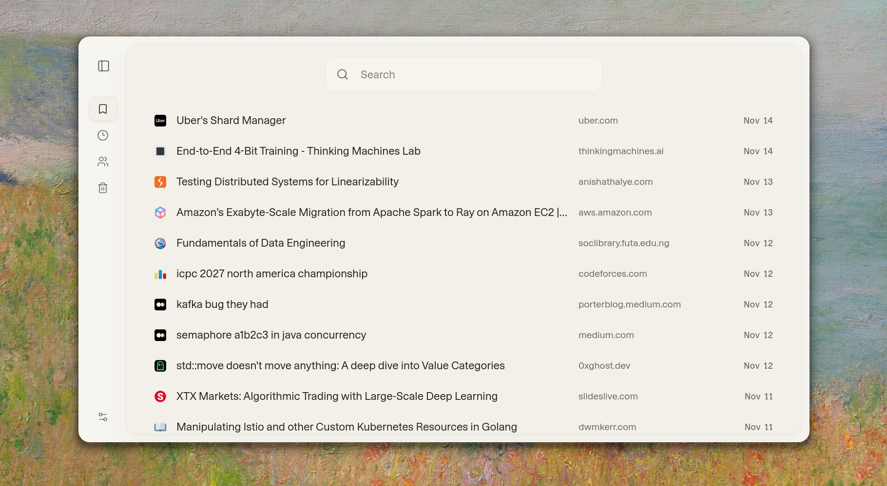

<div align="center">


# Prism

**Your links, notes, and people. A library that feels like yours.**

Save what catches your attention. Keep the context. Find it when it matters.

[](https://github.com/annalhq/prism/releases/tag/v0.2.0)
[](../LICENSE)
[](#browser-extensions)
[](#self-hosting)

[Explore the features](#a-home-for-what-you-find) · [Get started](#self-hosting) · [Download extensions](https://github.com/annalhq/prism/releases) · [Changelog](../CHANGELOG.md)

</div>

## Keep more than a link

An article you want to revisit. A post that changed how you think. A person whose work you follow. The notes you made while connecting it all.

Prism brings them together in a quiet, private workspace. Capture from your browser, organize around the people and topics that matter to you, and follow an idea as far as it takes you. A single omnibar and familiar keyboard shortcuts keep your library close at hand.

<div align="center">



<sub>A little less searching. A little more finding.</sub>

</div>

## A home for what you find

### Capture without losing your place

Save a page from the omnibar or send it straight from the Firefox and Chrome extensions. Prism fetches page titles and favicons, gives X/Twitter posts rich cards, and adds automatic tweet tags. Save posts directly from X or [OldTwitter](https://github.com/dimdenGD/OldTwitter), created by [dimden](https://github.com/dimdenGD), while you browse.

No connection? The extension queues your saves until you're back online.

### Give every save some context

Add tags, connect people, and write Markdown notes alongside your bookmarks. Create standalone text notes when the thought itself is worth keeping. Rich previews make it easier to revisit what you wrote; references and backlinks help you move between related items.

### Follow the rabbit hole

One useful link often leads to another. Rabbit holes let you keep that trail as a hierarchy of linked bookmarks, with room to branch as an idea develops. Return to the path you followed, not just the last page you saved.

### Remember the people behind the ideas

Build profiles with linked identities, social links, and profile pictures from multiple social avatar providers. Person timelines and the people feed bring together what you've saved by or about someone, so their work stays connected across your library.

### Find your way back

Search titles and notes, combine `#tags` and `@people`, or narrow by site, date, and content type. Filters become chips as you type. Use the Tags explorer to browse a topic, reorder sidebar tags to suit your workflow, and keep useful queries as saved searches.

Read Later gives unfinished reading a place of its own. Trash lets you restore deleted items or remove them permanently.

### Make the space yours

Choose light or dark mode, turn subtle sound cues on or off, and move comfortably between desktop and mobile. The omnibar, bookmark editor, context menus, account panel, and mobile navigation have all been refined through v0.2.0.

Your cached library remains available offline on a trusted device, with changes syncing when you reconnect. Import and export your library as Prism JSON, or export pending work and drafts separately.

### Share on your terms

Prism is built around a private, single-owner library. Enable the optional read-only view at `/public` when you want others to browse. Mark tags as private to keep those tags and the items carrying them out of the public view.

## New in v0.2.0

This release adds more ways to keep your thoughts connected and makes everyday browsing feel smoother.

- **Chrome joins Firefox.** Capture pages and posts from either browser, with support for OldTwitter's bookmark button.
- **Markdown text notes.** Keep standalone writing alongside your links, with rich previews.
- **Rabbit holes.** Organize linked bookmarks into branching trails.
- **Richer people profiles.** Use multiple social avatar providers for profile pictures.
- **Tag visibility controls.** Change public visibility directly from the tag editor.
- **A refreshed workspace.** Redesigned landing and sign-in screens, omnibar, bookmark editor, person pages, account panel, context menus, and mobile navigation.
- **Smoother library updates.** Batched loading, cached search snapshots, more efficient idle syncing, and improved updates across tabs.
- **Updated photo storage.** Neon Object Storage replaces Backblaze B2 for person photos.

See the [full changelog](../CHANGELOG.md) for release details, fixes, and breaking changes.

## Browser extensions

Keep Prism within reach while you browse. Both extensions save into the same library, with tags and people available in the capture panel.

| Browser                      | Get started                                                       |
| ---------------------------- | ----------------------------------------------------------------- |
| Firefox                      | [Installation and signing guide](../extensions/firefox/README.md) |
| Chrome and Chromium browsers | [Installation guide](../extensions/chrome/README.md)              |

Download packages from [GitHub Releases](https://github.com/annalhq/prism/releases), or [build them yourself](#build-the-extensions).

To connect an extension, open **Account** in Prism and generate a pairing code. Enter it in the extension popup. Codes expire and work once; you can revoke a connection from Prism at any time.

Use **Alt + Shift + P** to open the capture popup, or click the toolbar icon. On X and OldTwitter, use the post's Prism save button to capture it in place.

## At the speed of thought

Prism works with a mouse or touch, with keyboard navigation available throughout the library. Press `?` in the app for the shortcut guide.

| Action                        | Shortcut            |
| ----------------------------- | ------------------- |
| Search your library           | `/` or `Ctrl / ⌘ F` |
| Capture a link                | `i`                 |
| Next / previous bookmark      | `j` / `k`           |
| First / last visible bookmark | `gg` / `G`          |
| Half a page down / up         | `Ctrl d` / `Ctrl u` |
| Open the focused link         | `o` or `Enter`      |
| Edit the focused bookmark     | `e` or `Space`      |
| Copy the focused link         | `y`                 |
| Focus the sidebar             | `f`                 |
| Account and settings          | `,`                 |
| Return to normal mode         | `Esc`               |

Navigation keys work in normal mode; typing in a field stays in that field.

### Search with a little more precision

Start with a word or phrase, then add filters as you need them.

| Try this                                    | To find                                      |
| ------------------------------------------- | -------------------------------------------- |
| `"distributed systems"`                     | An exact phrase                              |
| `title:design`                              | Words in a title                             |
| `#research #systems`                        | Items with both tags                         |
| `#{research, systems}`                      | Items with either tag                        |
| `@simon`                                    | Items connected to a person                  |
| `site:github.com`                           | Links from a site                            |
| `is:page` · `is:social` · `is:tweet`        | A particular kind of bookmark                |
| `is:later` · `is:untagged` · `is:trash`     | Your reading queue, untagged items, or trash |
| `has:note` · `has:people` · `has:backlinks` | Items with more context                      |
| `after:7d` · `before:2026-01`               | Items saved within a date range              |
| `-site:x.com` · `!#news`                    | Results excluding a site or tag              |

Combine filters in one query, such as `#research has:note after:7d`.

## Self-hosting

Run Prism for your own library. Each deployment is configured for one owner, with PostgreSQL for persistence and Neon Auth for sign-in.

### 1. Get the project

You'll need **Bun 1.4**, **Node.js 22.17+**, a PostgreSQL database, and Neon Auth. The project is built for Neon; person photos optionally use Neon Object Storage.

```sh
git clone https://github.com/annalhq/prism.git
cd prism
bun install --frozen-lockfile
cp frontend/.env.example frontend/.env
```

### 2. Configure your library

Fill in `frontend/.env` using the [environment template](../frontend/.env.example).

| Variable                  | Purpose                                                                   |
| ------------------------- | ------------------------------------------------------------------------- |
| `DATABASE_URL`            | Pooled PostgreSQL connection for the app                                  |
| `DATABASE_URL_DIRECT`     | Direct database connection for setup and migrations                       |
| `APP_ORIGIN`              | App origin, such as `http://localhost:5173`                               |
| `NEON_AUTH_BASE_URL`      | Your Neon Auth service URL                                                |
| `NEON_AUTH_COOKIE_SECRET` | Session cookie signing secret, at least 32 characters                     |
| `OWNER_SUBJECT`           | The Neon Auth user ID of the library owner                                |
| `LIBRARY_PUBLIC_VIEW`     | Optional: set to `enabled` to expose the read-only `/public` view         |
| `NEON_STORAGE_*`          | Optional: object storage settings for person photos                       |
| `DB_MIGRATION_TARGET`     | Set to `isolated` only for a confirmed disposable database or test branch |

Create the owner in Neon Auth and use that user's ID for `OWNER_SUBJECT` before initializing the library.

### 3. Initialize and run

For a fresh, isolated database, set `DB_MIGRATION_TARGET=isolated`, then run:

```sh
bun run db:inventory
bun run db:migrate
bun run db:init-owner
bun run dev
```

Open **http://localhost:5173** and sign in with the configured owner account.

The migration script requires an inventory of the same database from the past 24 hours and checks its migration history. These commands target an isolated database; existing production deployments require a reviewed migration path.

### Deployment

The repository includes [Vercel configuration](../vercel.json). Deploy from the repository root and configure the environment variables above for your deployment, with `APP_ORIGIN` set to its HTTPS origin. The production build command is `bun run build:vercel`.

## Development

Prism is built with **SvelteKit and Svelte 5**, **TypeScript**, **Drizzle ORM**, **PostgreSQL**, and **Neon Auth**. The browser extensions use **WXT** and share their capture experience across browsers.

```text
frontend/              Web app, database schema, migrations, and tests
extensions/shared/     Shared extension source and assets
extensions/firefox/    Firefox extension
extensions/chrome/     Chrome extension
```

| Command                    | Purpose                                         |
| -------------------------- | ----------------------------------------------- |
| `bun run dev`              | Start the web app locally                       |
| `bun run build`            | Build the web app for production                |
| `bun run check`            | Type-check the app and both extensions          |
| `bun run lint`             | Check formatting and lint the app               |
| `bun run test`             | Run unit tests                                  |
| `bun run test:integration` | Run integration tests                           |
| `bun run test:e2e`         | Run browser tests                               |
| `bun run bench:library`    | Run reproducible library performance benchmarks |
| `bun run db:generate`      | Generate migrations from the Drizzle schema     |

### Build the extensions

```sh
bun run dev:firefox
bun run dev:chrome
bun run build:extensions
bun run zip:extensions
```

Run the development command for your browser, or build both production packages. Outputs are written to each extension's `.output/` directory. See the [Firefox](../extensions/firefox/README.md) and [Chrome](../extensions/chrome/README.md) guides for loading, packaging, and signing instructions.

### Releases

The project uses Conventional Commits to maintain its [changelog](../CHANGELOG.md). Maintainers can run `bun run release` to bump workspace versions and prepare a version tag. Pushing the tag triggers the [release workflow](workflows/release.yml), which builds and packages both extensions for GitHub Releases. Firefox signing is available when the repository's signing credentials are configured.

## Contributing

Help make Prism a better place to keep things. Bug reports, thoughtful feature suggestions, documentation improvements, and pull requests are welcome.

- [Report a bug](https://github.com/annalhq/prism/issues/new) with steps to reproduce and your browser or environment.
- [Suggest an improvement](https://github.com/annalhq/prism/issues) or discuss a larger change before starting work.
- For code changes, keep pull requests focused and run `bun run check`, `bun run lint`, and the tests relevant to your change.

## License

Prism is licensed under the [MIT License](../LICENSE).

Third-party components retain their own licenses and copyright notices, including the [ocean renderer](../frontend/src/lib/ocean/LICENSE).

---

<div align="center">

<picture>
  <source media="(prefers-color-scheme: dark)" srcset="media/logo-light.svg">
  
</picture>

**A quiet place for everything you keep.**

[Source](https://github.com/annalhq/prism) · [Releases](https://github.com/annalhq/prism/releases) · [Issues](https://github.com/annalhq/prism/issues)

</div>
