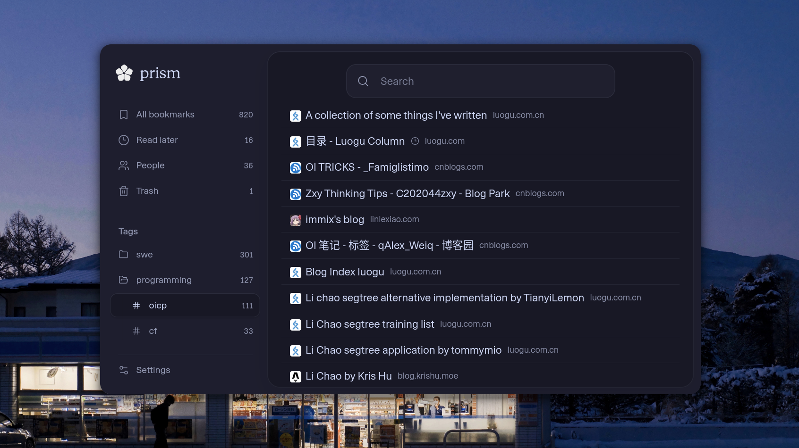
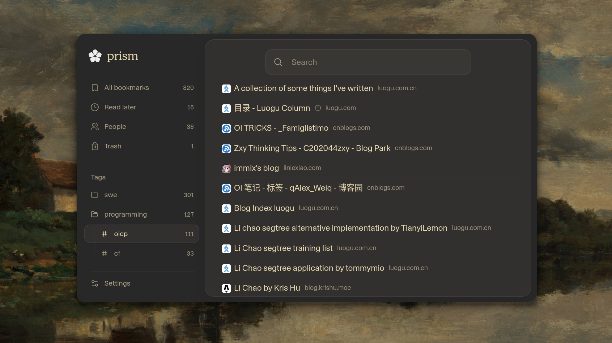
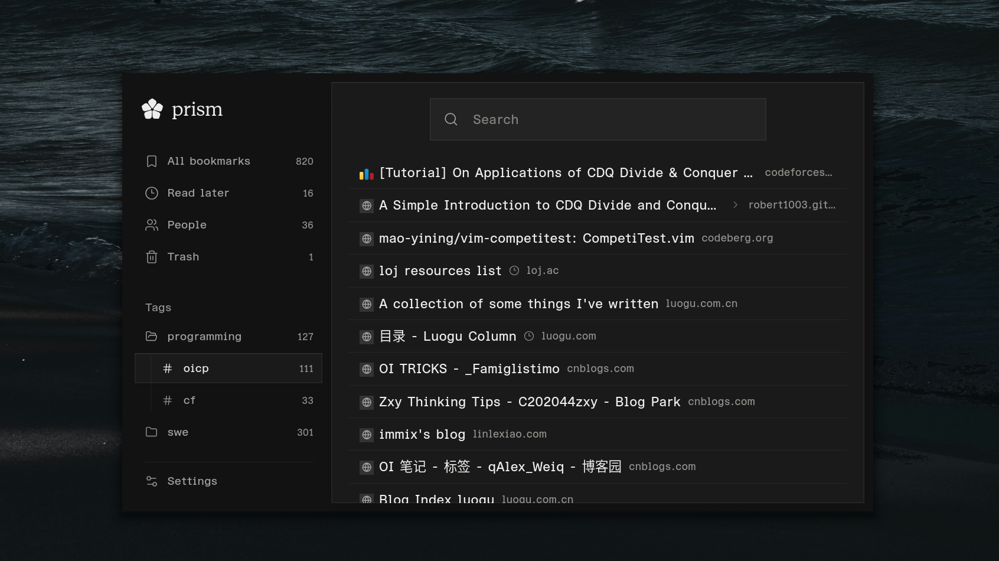

<div align="center">


# Prism

**A quiet place for everything you keep.**

Save links, notes and the people behind them in one private, self-hosted library.

[](https://github.com/annalhq/prism/releases)
[](../LICENSE)
[](#browser-extensions)

[Get started](#get-started) · [Extensions](#browser-extensions) · [Themes](theming.md) · [Changelog](../CHANGELOG.md)

</div>

<br>


## Features

- **Save anything.** Pages, X posts and plain notes, from the app or your browser.
- **Organise lightly.** Tags, folders of tags, and Read Later.
- **Keep context.** Markdown notes, linked people, and rabbit holes for trails of related links.
- **Find it again.** One search bar with filters like `#tag`, `@person` and `site:`.
- **Move fast.** Vim-style keys throughout; press `?` for the list.
- **Make it yours.** Themes, modules and a minimal list view, synced across devices.
- **Share if you want.** An optional read-only page, with private tags kept out.
- **Works offline.** Your library is cached on your device and syncs when you reconnect.

## Make it yours

So many possibilities to style. Start from **Zen dark** or **Zen light**, install themes like Kanagawa, Gruvbox and Catppuccin from the built-in gallery, or drop in your own JSON theme. Stack modules on top (Monospace, Rounded, Compact, Larger text), switch on square corners or the minimal list, and it all syncs to every device. See the [theming guide](theming.md).


<p align="center"><sub>Catppuccin Mocha</sub></p>


<p align="center"><sub>Gruvbox Dark</sub></p>


<p align="center"><sub>Zen dark with monospace module</sub></p>

## Get started

Prism runs as your own private library: one owner per deployment, built on [Neon](https://neon.tech) (Postgres and Neon Auth).

**You'll need:** [Bun 1.4](https://bun.sh), Node.js 22.17+, and a Neon project with Neon Auth enabled.

**1. Install**

```sh
git clone https://github.com/annalhq/prism.git
cd prism
bun install --frozen-lockfile
cp frontend/.env.example frontend/.env
```

**2. Configure** `frontend/.env`

| Variable                  | What to put                                                  |
| ------------------------- | ------------------------------------------------------------ |
| `DATABASE_URL`            | Your Neon pooled connection string                           |
| `DATABASE_URL_DIRECT`     | Your Neon direct connection string                           |
| `APP_ORIGIN`              | Where Prism runs, e.g. `http://localhost:5173`               |
| `NEON_AUTH_BASE_URL`      | Your Neon Auth URL                                           |
| `NEON_AUTH_COOKIE_SECRET` | Any random string of 32+ characters                          |
| `OWNER_SUBJECT`           | The user ID of your account in Neon Auth                     |
| `LIBRARY_PUBLIC_VIEW`     | Optional. `enabled` turns on the read-only `/public` page    |
| `NEON_STORAGE_*`          | Optional. Object storage for people's profile photos         |

Create your account in Neon Auth first, then copy its user ID into `OWNER_SUBJECT`.

**3. Set up and run**

```sh
bun run db:inventory
bun run db:migrate
bun run db:init-owner
bun run dev
```

Open **http://localhost:5173** and sign in.

**Deploy** to [Vercel](https://vercel.com) from the repository root with the same variables, and `APP_ORIGIN` set to your HTTPS address. The build command is `bun run build:vercel`.

**Upgrade** after pulling a new release: back up your database (on Neon, create a branch), then run

```sh
bun run db:inventory
PRISM_CONFIRM_UPGRADE=1 bun run db:migrate
```

## Browser extensions

Save pages and X posts without leaving them. Download the extension from [Releases](https://github.com/annalhq/prism/releases), then follow the guide for [Firefox](../extensions/firefox/README.md) or [Chrome](../extensions/chrome/README.md).

To connect it, open **Settings → Browser extension** in Prism, create a pairing code, and enter it in the extension. Press **Alt + Shift + P** to save the current page.

## Keyboard

| Key                 | Action                   |
| ------------------- | ------------------------ |
| `/` or `Ctrl / ⌘ F` | Search                   |
| `i`                 | Save a link or note      |
| `j` / `k`           | Next / previous bookmark |
| `o` or `Enter`      | Open                     |
| `e`                 | Edit                     |
| `x`                 | Move to a tag            |
| `v`                 | Visual mode, like Vim    |
| `,`                 | Settings                 |
| `?`                 | All shortcuts            |

## Search

| Type                        | To find                       |
| --------------------------- | ----------------------------- |
| `"exact phrase"`            | An exact phrase               |
| `#research`                 | Items with a tag              |
| `@simon`                    | Items connected to a person   |
| `site:github.com`           | Links from a site             |
| `is:later` · `has:note`     | Read Later, or items with notes |
| `after:7d`                  | Saved in the last week        |
| `-site:x.com`               | Exclude a site                |

Combine them, for example `#research has:note after:7d`.

## Development

Built with SvelteKit (Svelte 5), TypeScript, Drizzle ORM and PostgreSQL. The extensions use WXT.

| Command                    | Does                                  |
| -------------------------- | ------------------------------------- |
| `bun run dev`              | Run the web app                       |
| `bun run check`            | Type-check the app and extensions     |
| `bun run lint`             | Check formatting and lint             |
| `bun run test`             | Run unit tests                        |
| `bun run dev:firefox`      | Run the Firefox extension             |
| `bun run dev:chrome`       | Run the Chrome extension              |
| `bun run build:extensions` | Build both extensions                 |

Releases follow Conventional Commits; see the [changelog](../CHANGELOG.md).

## Contributing

Bug reports, ideas and pull requests are welcome. [Open an issue](https://github.com/annalhq/prism/issues) to report a bug or discuss a larger change, and run `bun run check` and `bun run lint` before sending a pull request.

## License

[MIT](../LICENSE)

---

<div align="center">

<picture>
  <source media="(prefers-color-scheme: dark)" srcset="media/logo-light.svg">
  
</picture>

**A quiet place for everything you keep.**

<sub>Logo by [@bymyno_](https://www.instagram.com/bymyno_/)</sub>

</div>
