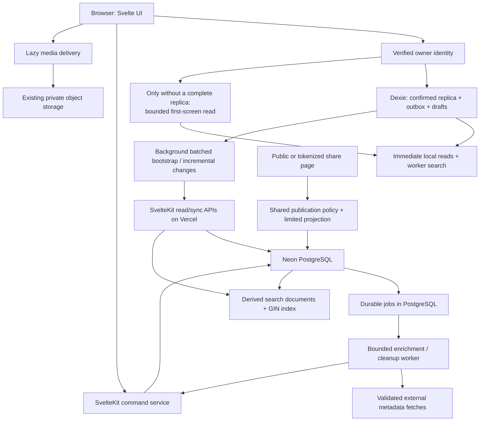

# Prism Next Version — Features and System Design

**Status:** Proposed roadmap. Checkboxes represent work to implement and verify, not features already delivered. No application changes or production migrations are authorized by this document alone.

**Objective:** Make Prism a complete, fast personal bookmark system: show useful content quickly, capture richer information, import/export standard formats, share precisely, and find relevant results. Keep repeat visits and everyday reads local, PostgreSQL authoritative, and infrastructure small enough for the existing Neon/Vercel setup.

## 1. Scope and priorities

| Priority | Deliverable | User benefit | Complexity |
| --- | --- | --- | --- |
| P0 | Reproducible performance and correctness checks | Know whether each release is faster and safe | Medium |
| P1 | First-screen preview before full bootstrap | New browsers show useful bookmarks sooner | Medium |
| P1 | Rich metadata with durable background enrichment | Better saves without slowing capture | Medium |
| P1 | Browser-standard bookmark HTML import/export | Bring existing bookmarks into Prism and leave easily | Medium |
| P1 | Explicit visibility and revocable share links | Share exactly the intended content | Medium–High |
| P1 | Local relevance ranking and indexed PostgreSQL search | Find the right result quickly at different collection sizes | Medium–High |
| P2 | Media/job lifecycle, recovery, and operational controls | Avoid silent failures, storage leaks, and lost work | Medium |
| P2 | CI, deployment checks, and export/restore documentation | Maintain the system confidently | Low–Medium |
| Later | Reader, highlights, RSS, scoped integrations | Expand only after the core release is stable | Separate projects |

### Current foundation to preserve

- Svelte 5 + SvelteKit, Drizzle + pg, Neon PostgreSQL, Vercel, private Neon Object Storage.
- Dexie records/outbox/drafts, optimistic commands, expected revisions, durable receipts, ordered sequence cursors, and tombstones.
- Batched bootstrap, adaptive polling, BroadcastChannel notifications, reusable worker search snapshots, and existing Chrome/Firefox extensions.
- Shared TanStack Markdown implementation currently in the repository. The earlier Sätteri migration proposal is superseded by the actual shared implementation; do not reintroduce multiple Markdown stacks for this release.
- People, relationships, backlinks, notes, note history, saved searches, private tags, and nested stashes.

## 2. Lightweight target architecture

### Ownership rules

1. PostgreSQL owns accepted data. IndexedDB is a recoverable replica plus durable unsent intent.
2. Preview/search responses are view data. They never advance a sync cursor or mark a partial replica complete.
3. One command service owns mutations, sequence changes, receipts, and emitted projections. Import, enrichment, and future integrations use it too.
4. Search documents are derived database data, not a second source of truth. They update transactionally with the records they index.
5. Sharing authorization is evaluated server-side through one publication policy. Client filtering is never an access-control boundary.
6. Metadata/media jobs are durable database records. In-memory promises and Vercel background execution are delivery aids, not job ownership.
7. No Redis, Elasticsearch, vector database, message broker, new ORM, or always-running server is required for these features.

### Proposed module boundaries

| Responsibility | Existing area / proposed addition |
| --- | --- |
| Owner/session verification | `frontend/src/lib/server/auth.ts`, `page-session.ts` |
| Preview and ordered list reads | Add `server/vault/bookmark-reads.ts` and `api/v1/bookmarks/+server.ts` |
| Commands / replica | Existing `server/vault/commands.ts`, projections, sync/bootstrap, client vault modules |
| Extraction and URL policy | Existing `server/metadata.ts`, `domain/urls.ts`; add metadata policy/job modules |
| Standard portability | Extend client portability; add dedicated Netscape-format parser/serializer |
| Sharing | Add `server/vault/sharing.ts`, public projection module, share routes/UI |
| Ranked search | Add `server/vault/search.ts`, search-document helpers, authenticated search route; extend local worker |
| Durable jobs | Extend `server/vault/maintenance.ts` and existing `maintenance_jobs` |
| Measurement / verification | Existing timing/perf modules, fixtures, scripts, unit/browser tests; add isolated integration tests |

Avoid turning `LibraryWorkspace.svelte` into the implementation location for all five projects. Keep it responsible for orchestration and views; place policies and data work in focused modules.

## 3. P0 — Baseline, performance budgets, and release checks

- [ ] Record current first document, identity verification, local replica open/read, first bookmark render, bootstrap completion, search, and visible-image timings.
- [ ] Compare fresh-browser/warm-backend, fresh-browser/cold-backend, complete local replica, expired session, and established offline use.
- [ ] Use deterministic fixtures at approximately 500 and 5,000 bookmarks, plus an empty vault. Include notes, relationships, Unicode, private tags, and stashes.
- [ ] Measure browser transfer by route separately from service-worker installation and whole-build totals. Include any image, worker, or optional-feature payload.
- [ ] Capture server auth/service/query timings and statement counts without logging private content, share tokens, or credentials.
- [ ] Check actual Vercel/Neon regions, pooled database endpoint, effective function limits, and idle connection lifecycle. Record unknown settings rather than assuming defaults.
- [ ] Add PR checks for frontend/extension types, unit tests, production builds, and targeted browser tests. Add an isolated database integration job for transactional/search/sharing changes.

**Initial design budgets — proposals to validate, not achieved measurements:**

| Path | Budget / required behavior |
| --- | --- |
| Complete local replica | No preview API call; cached rows appear before background sync completes |
| Empty local replica | One bounded list request can produce first content independently of bootstrap |
| Preview payload | Default 40 items, maximum 100, maximum 256 KiB including envelope |
| Preview SQL | At most three domain statements after owner resolution; no per-row queries |
| Saves | Durable local acknowledgement precedes metadata fetch; scrape failure never loses the save |
| Search | Local feedback remains immediate; online text search debounced 200 ms, cancellable, no full-library response |
| Background work | Explicit count/byte/time bounds below the verified function and request deadlines |
| Privacy change | New shared requests reflect the committed policy; no shared CDN cache delays revocation |

Report before/after medians and tail observations under identical conditions. Set absolute time targets after the baseline; do not invent latency gains from static analysis.

## 4. P1 — Useful first content before complete replication

**Problem:** Current batched bootstrap still waits for a complete staged replica and catch-up before showing bookmarks in a fresh browser.

### Design

- [ ] Add authenticated `GET /api/v1/bookmarks?limit=40&after=...` for bounded first-screen reads, ordered by creation time descending and ID descending.
- [ ] Return a minimal card projection: ID, title, description excerpt, URL/domain, kind, lifecycle/revision/sequence, collection ID, bounded tag IDs, and note-presence flag. Omit note bodies, histories, unrelated people graphs, media bytes, and search internals.
- [ ] Batch page dependencies; use `limit + 1` to determine continuation. Do not issue a global `COUNT(*)` just to display the first page.
- [ ] Use native `(created_at, id)` keyset predicates, scoped to the owner vault and lifecycle filters. Verify the actual query plan and existing index ordering before adding a new index.
- [ ] Encode/validate cursor version, vault, sort, and filter fingerprint. Reject malformed or mismatched cursors. Keep preview cursors separate from synchronization cursors.
- [ ] After identity verification, check IndexedDB first. If its complete cursor exists, publish it immediately and skip preview. Otherwise start preview and bootstrap concurrently, with no more than one active preview and one active bootstrap request.
- [ ] Render preview rows from a separate in-memory view. Keep source links usable and show background download state without a blocking page loader.
- [ ] Permit new capture through the existing durable queue after verified storage initialization; keep edits that require missing confirmed revisions disabled until the relevant record/replica is ready. Never fabricate revisions from preview data.
- [ ] On complete bootstrap, atomically switch data ownership to the replica, preserving selection/scroll and stable keyed rows. Never merge partial preview rows into Dexie confirmed tables.
- [ ] Ignore responses after navigation, owner change, or replica completion. Show a retryable error if preview fails while bootstrap continues.
- [ ] Keep server-first SSR bookmark seeding as a measured follow-up. The initial implementation avoids a mandatory preview SQL query on every returning user's document request.

**Acceptance:** A cold browser can open a visible bookmark before full bootstrap completes. A warm browser makes zero preview requests. Partial responses never mark the replica ready, overwrite newer local data, or expose another owner's content. Empty, slow, failed, and concurrent-mutation cases have browser/integration coverage.

**Files:** New bookmark reads/route; client vault lifecycle; workspace loading/view boundary; projection helpers; perf fixtures.

## 5. P1 — Rich capture, resolved URLs, and safe cleanup

**Problem:** Capture currently emphasizes titles. Descriptions, destination context, redirect resolution, and preview metadata should be obtained without blocking saves.

### Data model

- [ ] Preserve the submitted URL and existing canonical identity. Add explicit metadata for resolved URL, suggested cleaned URL, site name, extracted description/title, optional image candidate, fetch time, extractor version, source, and status.
- [ ] Track field provenance/intent: supplied by user, captured from browser, imported, or extracted. A user clearing a field is an explicit edit, not permission for a later job to refill it.
- [ ] Keep original identity and extracted candidates separate. Only a reviewed URL update changes canonical URL/hash and runs the existing uniqueness checks.
- [ ] Sync only compact presentation/provenance/status fields needed by the UI. Keep raw source HTML, fetch diagnostics, job leases, and retry payloads server-only; do not retain whole pages for metadata extraction.

### Save and enrichment lifecycle

- [ ] Commit capture and a deduplicated enrichment job in the same transaction. Reuse the existing jobs table; identify work by bookmark, URL revision/hash, and extractor version.
- [ ] Return the accepted command without waiting for DNS, page scraping, or images. Existing browser-provided title/description can display immediately.
- [ ] Claim jobs in a short transaction, fetch outside all vault/row locks, and apply accepted results through the command service in another transaction.
- [ ] Use a stable operation ID for the job's application receipt. Re-read lifecycle, current URL, and field provenance under the command lock before applying results; ignore stale results after edits/trash/purge.
- [ ] Start bounded processing after commit through a supported Vercel lifetime mechanism. Resume due work during coalesced authenticated activity if a background invocation is interrupted. Make jobs idempotent, leased, and retryable; never depend on a detached Promise surviving a response.
- [ ] Start with concurrency two, bounded attempts, backoff with jitter, and a terminal failure/retry state. Do not wake the database periodically just to poll jobs.
- [ ] Reuse the extraction result for capture suggestions and explicit refresh; avoid independent title, description, and image page fetches.

### Extraction and URL policy

- [ ] Extract bounded HTML head metadata: title, description, site name, candidate image, feed links where present, and redirect destination. Add document/article hints only where deterministic evidence exists.
- [ ] Enforce a single total deadline, redirect cap, decoded byte cap, supported content types, and response-body cancellation. Revalidate every redirect and protect against private-network destinations and DNS rebinding; use an enforceable connection policy, not only a separate DNS preflight.
- [ ] Resolve relative metadata URLs against the final document/base URL; validate schemes/credentials before persisting or serving candidates.
- [ ] Suggest removal only for an explicit tracking-parameter allowlist, such as `utm_*`, `fbclid`, and `gclid`. Preserve functional query parameters, path case, fragments, and signed URLs. Make changes reviewable and retain the original.
- [ ] Do not collapse all query strings, force `http`/`https` equivalence, trust arbitrary canonical tags, or silently merge redirect targets. Existing `normalizeUrl()` intentionally protects content identity.
- [ ] Treat a preview image as untrusted media. Do not fetch it as part of the first-screen SQL/read path. Start with an optional lazy remote preview with clear privacy behavior, or use bounded validated storage processing when proxying is required.
- [ ] Show pending/failed/refreshed state and an explicit refresh action. Failures preserve the saved URL and user edits.

**Acceptance:** Saves succeed when sites are slow, blocked, malformed, oversized, or unavailable. An enrichment retry cannot overwrite manual changes or resurrect deleted records. Functional URL parameters survive. One extraction provides all metadata fields.

**Files:** Metadata service; URL policy; bookmark schema/projections/contracts; command service; maintenance jobs; capture UI/extensions.

## 6. P1 — Standard bookmark portability

**Problem:** Prism JSON is useful for application-specific copies but does not accept the common bookmark export from browsers.

- [ ] Add Netscape bookmark HTML import/export alongside the existing Prism JSON format.
- [ ] Detect format from bounded file contents and structure, not only extension or MIME type. Parse HTML inertly; do not execute scripts, navigate links, or fetch metadata during parsing.
- [ ] Read browser titles, URLs, folder hierarchy, descriptions, and valid timestamps. Skip malformed/unsupported URLs and report exact counts/reasons.
- [ ] Preview the mapping before writes: top-level folders become collections; nested folder paths become tags using an escaped, deterministic naming convention shown in preview. Preserve original paths in the import report.
- [ ] Apply current validation limits. Do not silently truncate oversized names/titles or drop conflicting organization assignments without reporting them.
- [ ] Deduplicate within the file and against canonical identities in the vault using the same URL policy as normal capture. Default to skipping existing bookmarks rather than overwriting their notes/tags.
- [ ] Create an import session with stable operation IDs and bounded command chunks. Expose progress, partial success, cancellation, resumable retries, duplicate/conflict reports, and preserved source file/report guidance.
- [ ] Route imported writes through command/receipt/change-log handling; do not bypass the local replica protocol with direct table inserts.
- [ ] Keep enrichment off by default for bulk imports. Offer a separately bounded follow-up so a large file does not generate thousands of remote requests or jobs unexpectedly.
- [ ] Export active URL bookmarks as standard escaped HTML. Omit non-URL text/stash items with a count/report; preserve them in Prism JSON. Export dates/folders where representable and document format limitations.
- [ ] Preserve private visibility on import. External files never publish imported content automatically. Do not export access tokens, drafts, or other private application metadata into shared HTML.
- [ ] Keep Prism JSON for richer relationships, notes, pending work, and application-specific copies. Label its existing exclusions honestly; neither format is a complete database/media backup.

**Acceptance:** Chrome/Firefox HTML samples import correctly; a Prism HTML export opens in both browsers; repeated/resumed imports do not duplicate accepted work; malformed HTML and mid-import failures remain recoverable. Cover Unicode, escaping, nested folders, duplicates, dates, and existing private tags.

**Files:** New Netscape parser/serializer and tests; existing portability module; account import/export UI; optional bounded import service; command integration.

## 7. P1 — Precise publication and share links

**Problem:** Private-tag exclusions help, but users need direct publication intent and independently revocable shares for selected content.

### Publication model

- [ ] Add bookmark `visibility: private | unlisted | public`, defaulting new/imported bookmarks to `private`.
- [ ] `private`: excluded from all public/tokenized views. `unlisted`: eligible only through an authorized share scope. `public`: eligible for public pages and scoped shares.
- [ ] Keep private tags as a deny override: any attached private tag hides the bookmark even if visibility is public/unlisted. Explain the effective state in the editor.
- [ ] Add a share record for one bookmark, collection, or tag: scope, owner, hashed random token, creation/expiry/revocation times, and explicit options for including descriptions, notes, and tag names. Default notes and relationship disclosure off.
- [ ] Generate high-entropy tokens, show raw tokens only at creation/rotation, and store only hashes. Rotation invalidates the old token; revocation does not delete user content.
- [ ] Require both an active share scope and eligible visibility for every returned item. Collection membership alone never overrides private visibility. A share created for a collection is a live view of currently eligible members; show that behavior before creation.
- [ ] Use one `publicationPolicy` implementation for public pages, tokenized pages, search, exports, and any future feed/API. Scope/visibility checks are expressed in SQL or authorized before projections are assembled, not applied to already-serialized payloads.

### Delivery and consistency

- [ ] Add owner share management, effective-visibility preview, copy link, rotation, expiry, and revocation controls. Preview exactly the fields a visitor will receive.
- [ ] Tokenized share requests check current database authorization and use `Cache-Control: no-store`, `Referrer-Policy: no-referrer`, and no service-worker persistence. Redact tokens from logs/analytics and avoid third-party embeds on share pages.
- [ ] Public pages also revalidate current publication permissions on each request for the initial release. Remove the current 60-second shared-cache plus stale-serving policy when new privacy semantics become active.
- [ ] If anonymous traffic later justifies CDN caching, design tested purge/version behavior before enabling it; a cached success response must not continue serving revoked/private content.
- [ ] Return only bounded public projections. Do not expose vault IDs, hidden tags, private person links, backlink targets, drafts, history, object keys, or note bodies excluded by share options.
- [ ] Protect token lookup and anonymous expensive requests with bounded queries and host-level rate controls; invalid tokens return generic not-found responses.
- [ ] Migrate legacy public-view behavior explicitly: present a publication preview and require review before enabling the new visibility policy for existing content. Do not silently publish all existing records or pretend a new default preserves old semantics.
- [ ] Visibility/share mutations participate in the owner command/revision protocol so other tabs/devices show current effective state. Token secrets stay outside replica frames and exports.

**Acceptance:** Private-tag overrides, note exclusion, expiry, rotation, revocation, tag/collection changes, and concurrent requests are integration-tested. After a privacy commit, new responses disclose no restricted data. Previously downloaded content cannot be recalled; the UI must not promise otherwise.

**Files:** Schema/migrations; command/contracts/projections; public snapshot replacement; sharing policy/service/routes; editor/account share UI; public-view types/components.

## 8. P1 — Relevance ranking with local and PostgreSQL search

**Problem:** Current search has useful structured filters but lacks a ranked text relevance model. Server search must work before full replication and at larger collection sizes without making every warm-browser keystroke a database request.

### Database design: derived search documents

Prism's notes and bookmark metadata occupy different tables. A generated bookmark column cannot directly read another table's note body. Use a small derived table instead of duplicating ownership or pretending Otter's single-row generated expression fits unchanged.

- [ ] Add `bookmark_search_documents`, primary key `(vault_id, bookmark_id)`, containing normalized title, description, note plain text, URL, chosen search configuration, and source-version markers for metadata and note revisions.
- [ ] Add a stored weighted vector over that row: title weight A, description weight B, note text weight C, using explicit PostgreSQL text-search configurations. Apply equivalent configuration to parsing the query.
- [ ] Start with `simple` for general Unicode/identifier-friendly matching and explicitly test it against English stemming needs. If English stemming is enabled, make configuration selection deliberate and test multilingual titles; never assume all saved content is English.
- [ ] Add GIN on the vector for the `@@` predicate and retain vault-scoped identity/lifecycle indexes. Add `pg_trgm` URL indexing only if URL substring query plans at representative scale justify it; short substrings and tiny vaults may correctly use scans.
- [ ] Update the search document in the same transaction as accepted metadata/note commands, imports, enrichment, and purge. No asynchronous indexing lag for committed owner data. Keep note and metadata revision streams independent.
- [ ] Build note plain text with the existing shared Markdown policy; omit generated internal IDs/markup noise where appropriate. Do not send stored vectors or duplicate search documents through bootstrap.
- [ ] Backfill in bounded batches with revision guards so concurrent edits cannot be overwritten by an older backfill. Add an idempotent rebuild/verification command operating only on an explicitly selected database.

### Query behavior

- [ ] Add authenticated `GET /api/v1/search` with bounded text/filter/cursor inputs and a default page size of 40, maximum 100, maximum 256 KiB response.
- [ ] Parse Prism's existing query syntax into a shared validated filter representation. Resolve `#tag`, `@person`, collections, statuses, dates, negation, and saved-search semantics explicitly; do not feed the entire Prism query string into PostgreSQL's web-search parser.
- [ ] Use `websearch_to_tsquery(config, text)` for supported free-text phrases/operators and `ts_rank` for weighted results. Apply lifecycle, ownership, and structured filters before result projection.
- [ ] Union full-text, literal URL substring, and tag-name matches, deduplicate by bookmark ID, and assign documented match classes/boosts. Escape SQL wildcard characters for literal URL substring searches. Do not label substring matching as typo tolerance.
- [ ] Handle empty queries, stopword-only queries, quotes, minus signs, punctuation, URLs, and non-Latin text without surprising disappearance. Preserve existing Prism syntax where it conflicts with web-search semantics; unsupported forms return a useful validation message rather than silently changing meaning.
- [ ] Order deterministically by match class/score, creation time, and ID. Bind the keyset cursor to query/filter/configuration and relevant data-version metadata; if edits invalidate a ranking cursor, return a restart response rather than silently dropping results. Accept that continuously changing ranked results need a fresh query.
- [ ] Return compact result projections and bounded plain-text snippets. Escape snippet display; never inject untrusted `ts_headline` HTML into the UI.
- [ ] Do not return full counts by default. Use page-size-plus-one continuation and a separate count only if the product needs it.

### Fast local behavior

- [ ] Add local ranking: exact title, title phrase/token, description, note text, URL, then tag matches with explicit weights and deterministic tie-breaking. Build normalized fields/indexes once per worker content version.
- [ ] Keep local search as the default for complete replicas and offline use. Local ranking is an approximation, not falsely advertised as identical to PostgreSQL stemming/rank.
- [ ] Use server search during incomplete bootstrap and as an explicit library-wide/ranked mode when desired. Debounce online requests 200 ms, cancel obsolete requests, deduplicate identical in-flight queries, and ignore late results.
- [ ] Keep server results outside the confirmed replica. Do not combine incompatible local/server scores in one sorted list. Identify result mode and queued-unsynced limitations; local pending edits remain visible in local search.
- [ ] Preserve people/persona search and current filter/navigation behavior. The first PostgreSQL search slice covers bookmarks; do not silently remove other entity types from the existing local mode.

**Acceptance:** A relevance fixture ranks title matches above incidental note matches, finds descriptions/notes, supports literal URLs and tags, preserves structured filters, and behaves sensibly for Unicode/stopwords. Server plans use the intended indexes where selective. A committed note edit is searchable immediately; purge removes the search document. Rapid typing never flashes an older result.

**Files:** Schema/migrations; search-document service; note/bookmark command hooks; search route; shared query contracts; local search worker/client; search UI/saved-search sort validation.

## 9. P2 — Complete the supporting system

### Reliability and maintenance

- [ ] Implement bounded media deletion jobs already produced by purge/avatar replacement. Recheck live ownership before deleting, handle retryable storage errors, and provide backlog visibility.
- [ ] Define safe change-log/receipt retention and expired-lease cleanup. Preserve idempotency guarantees for old offline commands; receipt deletion is not safe merely because change frames can be pruned.
- [ ] Add user-facing retry, conflict, failed-enrichment, and import-progress views with request IDs where useful. Keep pending intent/draft export available during failures.
- [ ] Document browser storage eviction/quota recovery, database restore, object recovery, and the distinction between device JSON export and a full backup.
- [ ] Add rate controls for scraping/search/share requests appropriate to the actual deployment. Avoid a process-local map as the only cross-instance limit for expensive public work.
- [ ] Review query timeouts, pg pool reuse/lifecycle, and region alignment from measured data. Do not replace pg or add connections merely to mask slow queries.

### UX and media

- [ ] Add skeleton/partial loading states that preserve navigation and input focus; distinguish loading, empty, failed, and offline states.
- [ ] Lazy-load import/export and other infrequent heavy panels. Keep the critical list/preview path free of optional extractors/renderers.
- [ ] Keep preview images lazy with explicit dimensions/aspect-ratio, failure fallbacks, and byte limits. Avoid unbounded simultaneous favicon/image discovery.
- [ ] Revisit virtualization only if measured DOM cost after loading more rows warrants it; preserve keyboard selection and accessible navigation.
- [ ] Add narrowly useful capture affordances: duplicate preview, paste-to-save, and clear metadata-refresh controls where current workflows lack them.

## 10. Delivery sequence and migration safety

1. **Baseline and PR gates:** verify the current system and protect existing sync behavior.
2. **First-screen reads:** additive API/view changes; no data migration required.
3. **Metadata model and jobs:** additive fields/jobs, updated projections, optional enrichment; existing clients remain usable.
4. **Standard portability:** reuse command ingestion and existing URL rules; separate optional enrichment.
5. **Ranked search:** derived table, bounded guarded backfill, transaction hooks, then server and local ranking UI.
6. **Sharing:** additive visibility/share records, reviewed legacy publication transition, current-policy authorization, then share UI.
7. **Recovery and release review:** maintenance/backups, browser matrix, performance comparison, staged deployment.

- [ ] Keep schema changes additive and capability-negotiate changed replica/projection behavior. Old commands must not erase unknown metadata/visibility fields.
- [ ] Keep transport/protocol compatibility distinct from database migration versions. Do not invalidate every browser replica for a new read endpoint.
- [ ] Use isolated Neon branches or equivalent test databases for migrations and concurrent-write tests. Do not automatically copy private production data into public preview environments.
- [ ] Separate feature commits so preview, metadata, portability, ranking, and sharing can be reviewed and rolled back independently. Disabling a derived feature must not require destroying primary data.
- [ ] Run frontend/extension type checks, focused unit/integration/browser tests, web and both extension builds, and controlled before/after performance runs.
- [ ] Validate authorization failure, offline queues, lost responses, sibling-tab edits, private-tag changes, storage errors, and old-client behavior across the combined release.

## 11. Definition of done

- [ ] Fresh users see useful rows before complete replication; returning users retain local reads without extra preview requests.
- [ ] Rich capture is durable, nonblocking, safe to retry, and respects manual edits and URL identity.
- [ ] Standard browser HTML and Prism JSON both work for their documented purposes.
- [ ] Publication is explicit, scoped, revocable, and tested at query/serialization/cache boundaries.
- [ ] Search ranks relevant matches, indexes note changes transactionally, works before bootstrap, and preserves fast local/offline use.
- [ ] New background work has count/byte/time/retry bounds and recoverable state.
- [ ] Current people/notes/stash/extension workflows remain functional; accepted performance gains are measured and reproducible.
- [ ] Core infrastructure remains the existing application, PostgreSQL, browser persistence, and object storage.

## 12. Follow-ups outside this release

- Article reader and extracted content stored separately from mandatory replica metadata.
- Reading position/highlights after reader demand is established.
- RSS subscriptions/feed ingestion with explicit refresh costs and duplicate handling.
- Small scoped API/MCP/launcher integration backed by the command service.
- Thumbnail generation/private signed media delivery if media measurements justify them.
- AI tagging/rewriting only as an optional, separately budgeted enhancement.

Do not expand this release into native apps, broad media tracking, social-network backup, or a new hosting stack before the five core capabilities and their reliability work are complete.

## References

- Otter source inspected at commit `cd104a85e61c217e87a3993afb7790b2e2112a67`: https://github.com/mrmartineau/Otter/tree/cd104a85e61c217e87a3993afb7790b2e2112a67
- Otter repository structure reference supplied by the user: https://deepwiki.com/mrmartineau/Otter — unavailable through the browsing tool during this planning pass; source code remains the reference for verified behavior.
- PostgreSQL tables/indexes: https://www.postgresql.org/docs/current/textsearch-tables.html
- PostgreSQL query parsing/weighting/ranking: https://www.postgresql.org/docs/current/textsearch-controls.html
- Existing implementation details: `frontend/src/lib/client/vault/library.ts`, `server/vault/bootstrap.ts`, `server/vault/commands.ts`, `server/vault/public-view.ts`, `domain/urls.ts`, `client/search.ts`, and `client/vault/portability.ts`.
