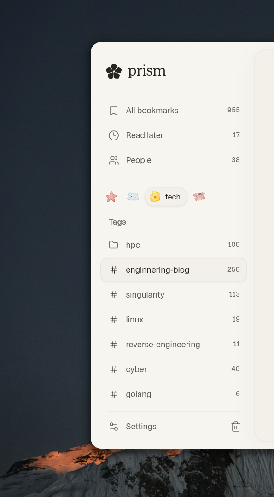
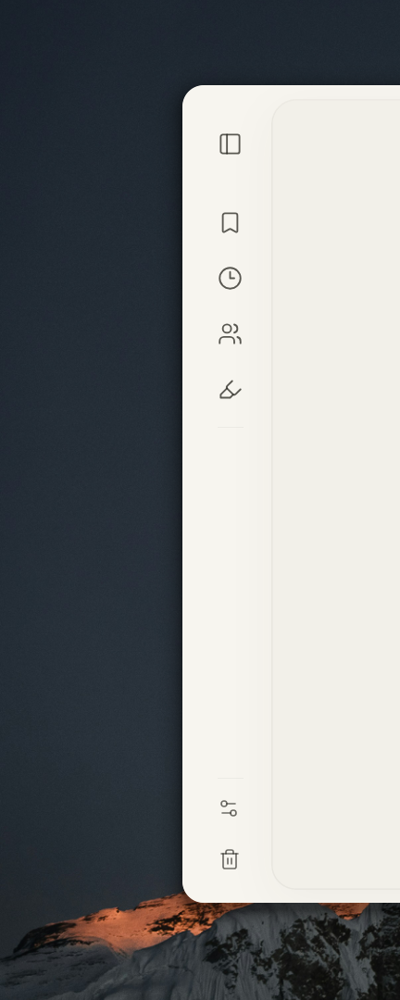

# Using Prism

[Back to Prism](../.github/README.md)

## Capture and revisit

Save links and Markdown notes from the app. To capture a page, X post, or selected passage while browsing, install the [Firefox](../extensions/firefox/README.md) or [Chrome](../extensions/chrome/README.md) extension. Open **Highlights** in Prism to read your saved passages together.

Use **Settings → Library → Data** to import bookmarks from a browser HTML file or a Prism JSON export. Browser HTML is useful for moving links between browsers. Use Prism JSON to carry over notes, people, and connections.

## Spaces and the sidebar

Spaces group tags and tag folders so you can switch between contexts such as work and personal reading. Use **New space** in the space switcher, choose the tags and folders it should show, and give it a sticker if you like. Drag the space tabs to reorder them. On mobile, use the tabs on the **Tags** page to switch spaces.

Under **Settings → Appearance → Sidebar**, choose **List** for rows or **Quad** for up to four tiles. Use the sidebar toggle to collapse it to icons.

  
  
   
  List layout · Collapsed sidebar

## Search

Open search with `/` or `Ctrl+F` (`⌘+F` on macOS). Combine terms to narrow the results, as in `#research has:note after:7d`.

| Query                  | Matches                             |
| ---------------------- | ----------------------------------- |
| `"exact phrase"`       | An exact phrase                     |
| `#research`            | Items with the research tag         |
| `#{design, research}`  | Items with either tag               |
| `@simon`               | Items connected to Simon            |
| `site:github.com`      | Links from GitHub                   |
| `title:"reading list"` | Items with that phrase in the title |
| `is:later`             | Items in Read Later                 |
| `has:note`             | Items with notes                    |
| `after:7d`             | Items saved in the last seven days  |
| `-site:x.com`          | Results with X links excluded       |

## Keyboard shortcuts

Press `?` in the library to open the in-app shortcut reference. Press `Esc` to leave a field or the omnibar and return to normal mode.

| Key           | Action                                   |
| ------------- | ---------------------------------------- |
| `i`           | Start saving a link or note              |
| `j` / `k`     | Focus the next or previous bookmark      |
| `gg` / `G`    | Focus the first or last visible bookmark |
| `f`           | Focus the sidebar                        |
| `o` / `Enter` | Open the focused bookmark                |
| `e` / `Space` | Edit the focused bookmark                |
| `y`           | Copy the focused link                    |
| `x`           | Move the focused bookmark to a tag       |
| `dd`          | Move the focused bookmark to Trash       |
| `v`           | Start or leave visual selection          |
| `,`           | Open settings                            |

In visual mode, use the movement keys to extend the selection, then press `x` to move it, `y` to copy its links, or `d` to send it to Trash.
